# kona

Notes on SGI InfiniteReality (KONA), the graphics pipe in the Onyx2 and Onyx 3000, and the IRIX code that
drives it.

It's all read from IRIX 6.5.30 on an Onyx2 with one InfiniteReality2 pipe, plus SGI's manuals and published
papers. No IR3 or IR4 binaries are held yet. Every fact notes the binary and offset it came from and whether
it's established, inferred or still unknown.

## What's covered

- **Host commands:** the tokens the host sends to the pipe, and which GL calls send them.
- **Host interface and Xtalk widget:** registers and DMA. Some of the port internals are still unknown.
- **Geometry engines and ARM firmware:** the ARM image is fully disassembled and the engine word decoded. Most
  engine labels are only located so far.
- **Raster and texture boards:** the register set and bus words. The chip arithmetic and memory maps aren't
  known.
- **Display:** VOC, XMAP, DAC and cursor.
- **IRIX:** every ioctl, and about a quarter of the driver and library functions.

Chip pages are under [devices/](devices/README.md), the IRIX side under [software/](software/README.md).

## How a command reaches the screen

The detail is in [platforms/ir/architecture.md](platforms/ir/architecture.md).

<!-- Question: where does a host command go on its way to the screen, and which
boundaries are documented? Evidence: platforms/ir/architecture.md section 1 and
the chip lists it cites (rm.md, hip.md, dg.md). -->

```mermaid
flowchart LR
  host["host crossbar"] -- "Crosstown/Ktown cable, 800 MB/s each way" --> XG
  subgraph GE["geometry board"]
    XG["XG: Xtalk widget"] --- HIP["HIP: host interface"]
    HIP --> ARM["ARM CPU"]
    HIP -- "routed tokens" --> GED["distributor"]
    ARM -- "operands + handler to port 0x8c0" --> GEs["geometry engines"]
    GED --> GEs
    GEs --> BEF["BEF: back-end chip"]
  end
  subgraph RM["raster and texture boards"]
    pg["pg: pixel generator"] -- "80-bit" --> tf["tf: filter"]
    pg --> tg["tg: texture generator"] --> tf
    tg -- "2 x 73-bit" --> tm["tm: texture memory"] -- "16-bit" --> tf
    tf -- "5 x 16-bit" --> imp["imp: image processor"] -- "20-bit return" --> tf
  end
  BEF -- "raster bus: 64-bit word + 2-bit mode" --> RM
  imp -- "160-wire video bus to 4 XMAP chips" --> DG["display board"]
  HIP -- "video-controller bus, 8-bit" --> DG
```


The role names for pg, tg, tf, tm and imp are guesses from register prefixes and bus widths. The chips' own
names aren't written in any binary ([devices/rm/](devices/rm/README.md)).

## Using it

The headers and the crate live in [generated/](generated/). Don't edit them; they're built from the
TOML under `devices/` and `formats/`.

To run the checks yourself:

```sh
git clone https://github.com/jamesbraid/kona && cd kona
tools/setup-clone.sh --root /path/to/your/irix/files
retools/tools/re-run retools/tools/defs/ci-check
```

You'll need Podman, git, python3 and your own IRIX files. [evidence/irix-files.md](evidence/irix-files.md) lists
which ones.

## How far along

The tokens and ioctls are done. Most of the functions aren't. The open questions are in [questions/](questions/README.md).
If you spot a mistake or have a manual we don't, [open an issue](https://github.com/jamesbraid/kona/issues).

<!-- readme-coverage:begin: generated from evidence/inventory/summary.tsv -->
| Table | Rows | % understood | % located or better | Audited real (sample) |
|---|---:|---:|---:|---:|
| tokens | 617 | 99.8 | 100.0 | 95.5% (89) |
| ioctls | 55 | 100.0 | 100.0 | 90.0% (10) |
| mmio | 53 | 92.5 | 100.0 | n/a |
| spec-registers | 242 | 86.0 | 100.0 | 100.0% (8) |
| ucode | 4411 | 67.2 | 99.9 | 90.0% (20) |
| binaries | 599 | 78.1 | 99.3 | 100.0% (20) |
| functions | 54309 | 24.9 | 74.2 | 90.0% (20) |
<!-- readme-coverage:end -->

## License

[BSD 3-Clause](LICENSE). The `retools/` scripts started life as gr4's and keep its notice. No SGI binaries in
here; bring your own.

## Credits

James Braid, plus a lot of Claude and Codex reading MIPS and ARM disassembly so I didn't have to.

Thanks to -

* Dominik Behr ([@techomancer](https://github.com/techomancer)) for [gr2](https://github.com/techomancer/gr2)
  and [gr4](https://github.com/techomancer/gr4), where the layout and working style come from
* John Montrym and the rest of the InfiniteReality team, whose SIGGRAPH 97 paper lays out the
  whole pipe
* Everyone keeping SGI manuals, `hinv` dumps and IRIX media online
